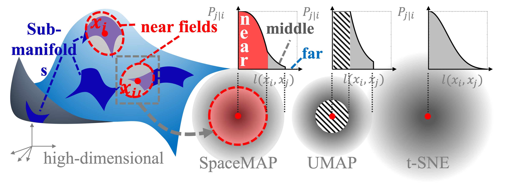
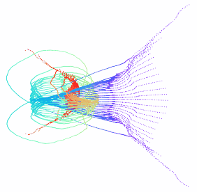

<p align="center">
  
  
</p>

# SpaceMAP

SpaceMAP is a dimensionality reduction method utilizing the local and global intrinsic dimensions of the data to better alleviate the 'crowding problem' analytically.

## Paper

[https://icml.cc/virtual/2022/spotlight/18170](https://icml.cc/virtual/2022/spotlight/18170)

[https://proceedings.mlr.press/v162/zu22a.html](https://proceedings.mlr.press/v162/zu22a.html)

## Hyper-parameters

SpaceMAP has 4 main hyper-parameters: n-near/n-middle and d-local/d-global, which define the intrinsic dimensions and the hierarchical manifold approximation.

- n-near: number of neighbors in the near fields of each data point. (default: 20)
- n-middle: number of neighbors in the middle field of each data point. (default: 1% of the whole dataset)
- d-local: estimated intrinsic dimensions of the near fields of each data point. (default: Auto)
- d-global: estimated intrinsic dimension of the whole dataset. (default: Auto)

## Installation

```bash
pip install spacemap-dr
```

## Usage

```python
from spacemap import SpaceMAP
import numpy as np

data = np.random.rand(1000, 100)
# Auto mode
spacemap = SpaceMAP()
# Manually change the parameters
spacemap = SpaceMAP(n_near_field=10, n_middle_field=100, d_local=0, d_global=0)

embedding = spacemap.fit_transform(data)
```

## Example

Please refer to the [example](https://github.com/zuxinrui/SpaceMAP/blob/main/main.py) for details.

# Citation

If you find SpaceMAP useful in your research, please consider citing:

```bibtex
@InProceedings{pmlr-v162-zu22a,
  title = 	 {{S}pace{MAP}: Visualizing High-Dimensional Data by Space Expansion},
  author =       {Zu, Xinrui and Tao, Qian},
  booktitle = 	 {Proceedings of the 39th International Conference on Machine Learning},
  pages = 	 {27707--27723},
  year = 	 {2022},
  editor = 	 {Chaudhuri, Kamalika and Jegelka, Stefanie and Song, Le and Szepesvari, Csaba and Niu, Gang and Sabato, Sivan},
  volume = 	 {162},
  series = 	 {Proceedings of Machine Learning Research},
  month = 	 {17--23 Jul},
  publisher =    {PMLR},
  pdf = 	 {https://proceedings.mlr.press/v162/zu22a/zu22a.pdf},
  url = 	 {https://proceedings.mlr.press/v162/zu22a.html},
}


